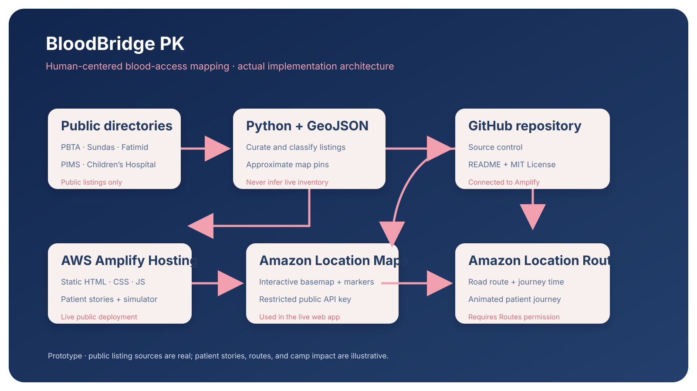

# BloodBridge PK 🩸

**Every drop matters. Every journey, too.**

BloodBridge PK is an interactive web application I built for the AWS Builder Center Weekend Challenge: Map It.

The idea is to help people explore publicly listed blood banks, hospitals, and thalassaemia support centers in Pakistan through an interactive map. I also wanted to make the experience more personal, so I included fictional patient stories and animated journeys.

**Live Website:** https://main.dazwp60yb9ian.amplifyapp.com/

**Project Demo:** https://youtu.be/mDQV92jd1Aw

## Why I Built This

When I was thinking about what to build for this challenge, I wanted to do something different from a regular location finder.

Families affected by thalassaemia often need to arrange regular transfusions. Finding a suitable center can involve checking different sources, contacting facilities, and figuring out how far they need to travel.

I started thinking about how mapping technology could make some of this information easier to explore.

That became BloodBridge PK.

I wanted the map to show more than just locations. I wanted people to understand the journey behind them.

## What the Application Does

BloodBridge PK currently covers Lahore and Islamabad/Rawalpindi.

I prepared a dataset of 31 publicly listed facilities, including 21 locations in Lahore and 10 in Islamabad/Rawalpindi.

Users can explore these locations on a map, filter different types of facilities, and view information about the selected center.

I also added six fictional patient scenarios to demonstrate how someone might explore support options from different starting locations.

### Patient Journey

One of the main features is the animated patient journey.

For example, users can select Areeba, a fictional eight-year-old patient from Lahore, and explore her surrounding care network.

After selecting a support center, the application displays a route or an illustrative straight-line preview, depending on whether an AWS route is available.

An animated ambulance then follows the displayed journey, with a distance counter showing its progress.

I added this feature because I wanted to make geographical distance easier to understand instead of only displaying a number.

The ambulance animation is a simulation. It is not connected to real emergency services.

### Interactive Map

The map includes location markers for blood banks, hospitals, and thalassaemia support centers.

I used marker clustering because some facilities are close together and individual markers can become difficult to navigate when the map is zoomed out.

Users can switch between cities, choose different patient stories, select facilities, and filter the displayed locations.

The blood group selection is only a demonstration input. It does not represent available blood stock or medical compatibility.

### Donation Camp Simulator

This is another feature I enjoyed working on.

I wanted to explore what might happen if an additional blood donation outreach point were introduced in a particular neighborhood.

The simulator lets users choose a proposed camp location and compares the modelled average distance to the nearest support point before and after adding it.

These calculations use straight-line distances across fictional sample neighborhood locations.

The results are hypothetical. They do not represent actual road travel, population coverage, or confirmed access to blood supplies.

The goal is to explore geographical access rather than predict real healthcare outcomes.

## Technologies I Used

### Amazon Location Service

I used Amazon Location Service for the interactive map and routing features.

The application uses Amazon Location Maps with MapLibre GL JS to display the geographical interface.

Amazon Location Routes is used to calculate road routes and travel information when a route is available. If a route cannot be retrieved, the application shows an illustrative straight-line preview instead.

### AWS Amplify

I deployed the frontend using AWS Amplify.

The application is connected to my GitHub repository, with the `main` branch used for deployment.

The website is a static application, so it does not require a continuously running backend server.

### Frontend

I used HTML, CSS, and JavaScript to build the interface, patient stories, map interactions, animations, and donation camp simulator.

MapLibre GL JS handles the interactive map.

### Python and GeoJSON

I used Python to prepare the facility dataset and generate GeoJSON.

The browser loads an embedded JavaScript version of this data so the map can display the facility listings without requiring a separate database or backend API.

## Project Architecture



The frontend is hosted on AWS Amplify. It loads the prepared facility data and connects to Amazon Location Service for maps and routing.

The Amazon Location API key is a public browser key with restricted permissions and allowed website origins. It is not an IAM secret access key.

## Project Structure

```text
BloodBridgePK/
│
├── app/
│   ├── index.html
│   ├── style.css
│   ├── app.js
│   ├── config.js
│   ├── favicon.svg
│   └── data/
│       ├── centers.geojson
│       └── centers.js
│
├── assets/
│   └── BloodBridgePK_architecture_FINAL.svg
│
├── scripts/
│   ├── build_dataset.py
│   └── embed_dataset.py
│
├── tests/
│   └── test_dataset.py
│
├── amplify.yml
├── LICENSE
└── README.md
```

## Running the Project Locally

Clone the repository:

```bash
git clone https://github.com/KashfaMuskan329/BloodBridgePK.git
cd BloodBridgePK
```

Start a local web server:

```bash
python -m http.server 8000 --directory app
```

Then open:

```text
http://localhost:8000
```

The frontend needs an internet connection to load the map library and map tiles.

If you are setting up your own Amazon Location configuration, use an authorized public API key in `app/config.js` and allow your local origin in the API key restrictions.

Never put AWS IAM secret access keys in frontend code.

To regenerate the facility dataset:

```bash
python scripts/build_dataset.py
```

To rebuild the browser's JavaScript dataset from the GeoJSON file:

```bash
python scripts/embed_dataset.py
```

To run the dataset tests:

```bash
python -m unittest discover -s tests -v
```

The frontend is deployed using the `amplify.yml` configuration, which publishes the contents of the `app` directory.

## Dataset and Limitations

The dataset contains manually curated public facility listings from sources including the Punjab Blood Transfusion Authority, Sundas Foundation, Fatimid Foundation, Children's Hospital Lahore, PIMS, and other public directories.

The coordinates are approximate neighborhood locations, not verified facility entrances.

Some directory listings may be historical, so the current operating status of a facility should not be assumed.

BloodBridge PK is an educational prototype. It does not provide real-time blood availability, verified medical eligibility, emergency services, or real ambulance tracking.

All patient stories, starting locations, and proposed donation camps are fictional. No private patient records are used.

Anyone planning an actual visit should contact the relevant healthcare provider directly.

## Challenges and What I Learned

The part that took the most effort was making the map, patient journeys, and facility data work together.

I had to work through map configuration, API permissions, route calculations, marker positioning, and ambulance animation behavior.

I also had to think carefully about how to present the facility information because approximate coordinates and publicly listed addresses should not be confused with verified medical information.

Working on the simulator was interesting too. I wanted the Before and After comparison to be understandable without making claims that the data could not support.

This project helped me gain more practical experience with AWS Amplify, Amazon Location Service, geospatial data, and frontend development.

It also made me think more about the experience of the person using an application, rather than focusing only on the technical features.

## What I Would Improve Next

I'd like to add more cities, improve facility coordinate accuracy, and explore ways to keep facility information updated through verified sources.

Another improvement would be better accessibility and mobile usability.

For this challenge, I focused on making a working prototype that demonstrates the concept clearly.

## Final Thoughts

BloodBridge PK started as an idea for a map, but it became a project about making geographical information easier to understand.

It's still a prototype, and there's a lot that could be improved.

But building it helped me see how cloud services, mapping, and simple storytelling can work together to explore a meaningful problem.

**Behind every pin on a map, there's a person.**

**Every drop matters. Every journey, too.**

Built for the AWS Builder Center Weekend Challenge: Map It.

## License

This project is available under the MIT License. See [LICENSE](LICENSE) for details.
